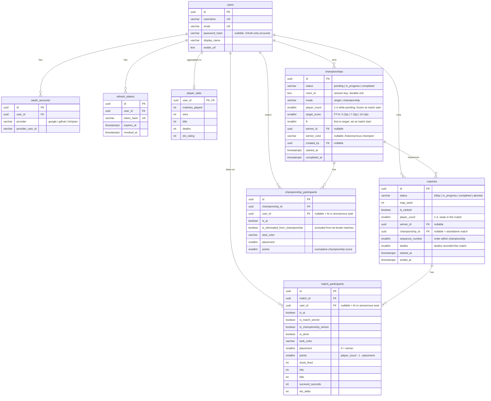

# Database Schema — Tank It!

Postgres. Source of truth for the DDL is the EF Core migration in
[`backend/src/TankIt.Api/Migrations/`](../backend/src/TankIt.Api/Migrations/), generated
from the entity classes in `backend/src/TankIt.Api/Data/` (`AppDbContext.OnModelCreating`
holds lengths, defaults, CHECKs, and index names). [`db/init/schema.sql`](../db/init/schema.sql)
is a frozen reference baseline — manually kept equivalent, no longer applied automatically.
When the model changes: update `AppDbContext`, `make db-migration-add name=...`, verify the
generated migration, then update this doc.

Scope: this schema covers exactly the modules the team has committed to (see `docs/GDD.md` §5)
— standard User Management + auth, Remote auth (OAuth), Game stats & match history, and
Tournament system (delivered as the Championship/FT-N mode below, not a bracket). It does
not include tables for modules that weren't picked (chat, gamification/XP) — add them later
if those get scoped in, rather than building for hypothetical scope now.

## Entity-relationship diagram



## Design notes

**Why `player_stats` is separate from `match_participants`.** `match_participants` is the
append-only ledger (one row per player per match — the source of truth for match history).
`player_stats` is a denormalized rollup, one row per user, updated in the same transaction that
closes a match. Rankings/profile reads hit `player_stats` (cheap, indexed on `elo_rating`)
instead of aggregating `match_participants` on every page load.

**Why AI opponents don't get a `users` row.** `match_participants.user_id` is nullable with
`is_ai` as the discriminator, rather than creating synthetic bot user accounts. Keeps `users`
authoritative for real accounts only — auth and rankings never need to filter out bots.

**Why `elo_rating` isn't just "wins minus losses."** Battle royale matches have 2–4
participants and a `placement`, not a binary win/loss — an Elo-style rating (adjusted by how
many opponents you beat in a match, not just whether you were 1st) is a better fit than a
simple W/L record and gives the ranking feature (already planned in the proposal's landing
page) something meaningful to sort by. The exact rating-delta formula is a backend
implementation detail, not a schema concern — `match_participants.elo_delta` just stores the
outcome per match for auditability.

**Why `password_hash` is nullable.** A user who signs up via OAuth only (Google/GitHub/42)
never sets a password. Login logic must check `oauth_accounts` when `password_hash IS NULL`.

## Championship mode (FT-N)

**Durable unit:** there is no separate `rooms` table. A `championships` row is the persistent
session — its `room_id` is a text key from the lobby/URL that groups all matches and participants
for that session. Single matches also get a `championships` row with `mode = 'single'`; the
`room_id` behaves identically. Match-end eviction soft-completes the series and drops hot caches;
rejoining with the same `room_id` creates a fresh series row.

A championship is a fixed-roster race to a target score. `championship_participants` defines
the seats (1–4 while the lobby is open, AI allowed); `championships.player_count` tracks the
current seat count while pending and is frozen when the first match starts. From then on every
`matches` row belonging to that championship (`matches.championship_id` set) uses the same
`player_count` and gets a `sequence_number` marking its order in the series — enforced by
`uq_matches_championship_sequence`, a unique index on `(championship_id, sequence_number)`.

**Scoring, generalized from your rule.** For an N-player match, the winner scores N−1 and
the first player to die scores 0. A 4-player match gives 0/1/2/3 exactly as specified;
this generalizes cleanly to 3-player (0/1/2) and 2-player (0/1) matches. `points` is populated
for every match, not just championship ones — it's cheap to compute and useful for stats
either way.

**Target score by roster size** (`championships.target_score`, set by the app when the first
match starts, not a DB default, so it stays overridable): 4 players → FT10, 3 players → FT7,
2 players → FT5. Chosen so the number of matches-to-decide-it stays roughly comparable across roster
sizes, not derived from a formula — these are the numbers from the discussion, stored
explicitly for auditability.

**End-of-match check.** After every completed match in a championship, the backend recomputes
each participant's cumulative `SUM(points)`. If nobody has reached `target_score`, the series
continues. If exactly one participant has, they're champion. Because the check only runs after
a match completes, two participants can only cross the threshold _simultaneously_, in the same
deciding match — which is exactly your dark=11/green=12 example: unequal totals, green wins
outright, no tie-break needed.

Standings query (cumulative points drive the FT win check):

```sql
SELECT
  u.id, u.display_name,
  SUM(mp.points) AS total_points
FROM match_participants mp
JOIN matches m ON m.id = mp.match_id
JOIN users u ON u.id = mp.user_id
WHERE m.championship_id = $championshipId AND mp.user_id IS NOT NULL
GROUP BY u.id, u.display_name
ORDER BY total_points DESC;
```

Note: `match_participants.placement` is 0-indexed (0 = winner) in the current settlement code,
so a `COUNT(placement = 1)` "matches won" column would be wrong. Tie-breaking does not use it.

**Tie-break (exact tie only — same total at/above target).** When 2+ participants land on the
same cumulative `points` at/above `target_score` after a match:

- Non-leaders are eliminated from the series via `championship_participants.is_eliminated_from_championship = true`.
- The tied leaders replay additional matches among themselves — only non-eliminated participants
  are copied into the next `Match` (`activeColors` in `MatchStarted` tells clients who plays).
- After each match, `SUM(points)` is re-checked. The cycle repeats until exactly one participant
  has sole leadership at/above target — that participant is the champion.
- There is no kills comparison, matches-won comparison, head-to-head step, or sudden-death
  decider. The tie is resolved by repeated play among the tied players.

No new schema is needed for tie-break matches: they are ordinary `matches` rows with
`championship_id` set and `sequence_number` continuing the series, with `match_participants`
limited to the tied subset.

## Not in this schema (out of scope per committed modules)

- Chat / messages — not selected as a buffer module.
- Achievements / XP / gamification — not selected.
- Friends / friendship (and, as a consequence, online status/presence) — dropped by team
  decision (2026-08-11); see `docs/GDD.md` §5.2.
- Health checks — the buffer "Health check / status page" module is a stateless liveness
  endpoint (backend process + DB connectivity check), not persisted state.

If the team later decides to add any of these, extend this file and add an EF Core
migration (`make db-migration-add name=...`) rather than improvising a table ad hoc
in the backend.
